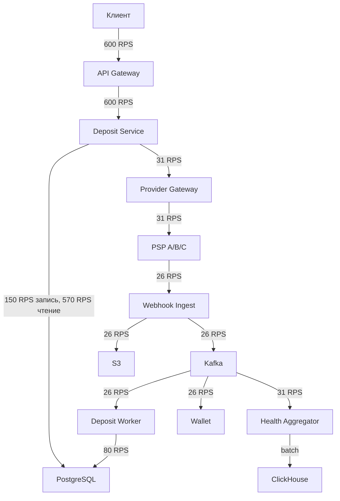
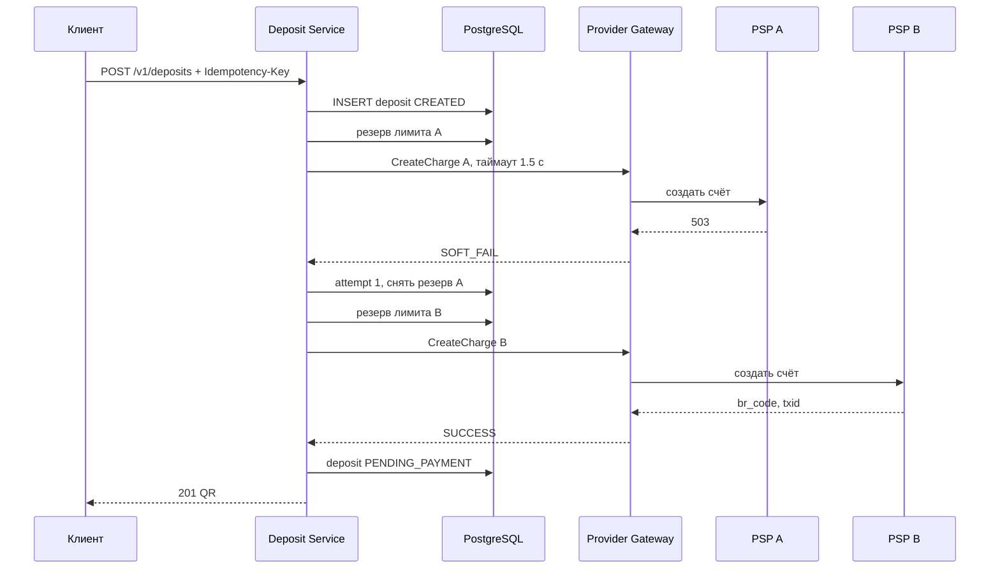

# Каскадный роутинг PIX-депозита

## Содержание

- [Контекст и допущения](#контекст-и-допущения)
- [1. Требования](#1-требования)
- [2. Модель данных и API](#2-модель-данных-и-api)
- [3. Архитектура](#3-архитектура)
- [4. Технологии и отказоустойчивость](#4-технологии-и-отказоустойчивость)
- [Итог](#итог)

---

## Контекст и допущения

Исхожу из нескольких допущений. Платформа работает в Бразилии и принимает PIX от физлиц. Это может быть iGaming, брокер или e-wallet. Подключено от трёх до пяти провайдеров. Кошелёк, KYC и антифрод уже существуют, их я не проектирую. Возвраты и споры через MED тоже оставляю за рамками.

---

## 1. Требования

### Функциональные требования

1. Игрок создаёт депозит в BRL.
2. Система строит цепочку провайдеров с учётом правил, лимитов и состояния провайдеров.
3. Система по очереди пробует выставить PIX-счёт у провайдеров из цепочки.
4. Игрок получает QR-код и строку Copia e Cola, затем платит в своём банке.
5. Игрок видит статус депозита.
6. Провайдер присылает вебхук об оплате, система сообщает об оплате кошельку.
7. Если вебхук не пришёл, система сама запрашивает статус у провайдера.
8. Если QR истёк без оплаты, депозит переходит в `EXPIRED`.
9. Игрок просматривает историю своих депозитов.
10. Администратор настраивает правила роутинга и включает или отключает провайдеров.
11. Система считает статистику по провайдерам для выбора маршрута.

### Нагрузка

- MAU — 2 млн, вовлечённость беру 0.3. DAU = 2 000 000 × 0.3 = **600 000**.
- Отношение DAU/MAU у транзакционных продуктов обычно 20–40%.
- Активность длится 16 часов: 16 × 3 600 = **57 600 секунд**.
- Коэффициент пика — **×5**. Вечерний час даёт ×2.5, выходные, матчи и зарплаты — ещё ×2.
- Средний RPS = операций в день / 57 600. Пиковый RPS = средний RPS × 5.

| Операция | Тип | Частота | В день | Пиковый RPS |
|---|---|---|---:|---:|
| Создание депозита | запись | 0.5 на DAU | 300 000 | 26 |
| Запросы к провайдерам | внешняя запись | 1.2 попытки на депозит | 360 000 | 31 |
| Статус депозита | чтение | опрос раз в 3 с около минуты | 6 000 000 | 520 |
| История | чтение | 1 просмотр на DAU | 600 000 | 52 |
| Вебхуки | изменение | 1 на депозит | 300 000 | 26 |

- 1.2 попытки получается так: 80% депозитов проходят у первого провайдера, 20% — у второго. 0.8 × 1 + 0.2 × 2 = 1.2.
- В пике около 600 RPS, из них на запись — около 50. Главная сложность — надёжность, а не масштаб.
- За год набирается около 110 млн депозитов: 300 000 × 365.
- Строка депозита занимает около 1 КБ с индексами. Основной вклад дают BR Code, UUID, txid и таймстемпы.
- В PostgreSQL выходит около **260 ГБ в год**, в S3 для аудита — около **0.75 ТБ**.

### Нефункциональные характеристики

- **Availability создания депозита:** SLO 99.95%, это около 4.4 часа простоя в год. При 99.9% было бы 8.7 часа, а это прямая потеря выручки.
- **Availability приёма вебхуков:** SLO 99.99%, около 53 минут в год. Потерянный вебхук означает, что игрок заплатил, но денег не видит.
- **Reliability:** ноль потерянных и ноль двойных зачислений. 99.9% зачислений проходят за 60 секунд, остальные догоняет реконсиляция.
- **Consistency:** strong для денег, лимитов и статусов. Eventual для статуса на экране, истории и статистики, их читаю с реплики.
- **Latency:** создание депозита — p95 ≤ 1.5 с, p99 ≤ 4 с. Три попытки по 1.5 с укладываются в SLA 5 с. Статус — p99 ≤ 100 мс.
- SLA — обязательство перед бизнесом, оно на ступень мягче. SLO — моя внутренняя цель. SLI — фактическая метрика из Prometheus.

---

## 2. Модель данных и API

### Модель данных

Центральной сущностью является таблица `deposit`, источник правды по деньгам. В ней я храню пользователя, сумму, статус, провайдера, txid, BR Code и срок жизни QR. Сумму держу в `numeric`, а не во `float`, чтобы не ловить ошибки округления. Пару `user_id` и `idempotency_key` делаю уникальной. Так повторный запрос не создаст второй депозит. Уникальный `txid` гарантирует, что вебхук сопоставится ровно с одним депозитом. Индекс по `user_id` и `created_at` обслуживает историю. Индекс по `status` и `expires_at` нужен фоновым джобам. Таблицу партиционирую по месяцам.

Каждую попытку каскада записываю в `deposit_attempt`. С депозитом её связывает отношение один ко многим. В попытке лежат провайдер, номер попытки, результат, код ошибки и время ответа. Результат `TIMEOUT_UNKNOWN` я ввёл осознанно. При таймауте счёт у провайдера мог успеть создаться, и его нужно отменить.

Провайдеров описываю в таблице `provider`. Там флаг включения, допустимые суммы, дневной лимит и комиссия. Лимит резервирую атомарно, одним `UPDATE` с условием на остаток. Лимит — это деньги, поэтому кэш для него не подходит.

Правила роутинга храню в `routing_rule`. Условия и цепочку провайдеров кладу в `jsonb`. Поле `version` защищает от одновременной правки двумя администраторами. Состояние провайдеров раз в 30 секунд записывается в `provider_health`. Там успешность за 5 минут, конверсия в оплату за час и p95.

Ещё у меня две служебные таблицы. `webhook_inbox` с уникальным ключом события отсекает дубли вебхуков. `outbox` гарантирует, что событие уйдёт в Kafka только после коммита.

### API

Наружу я отдаю небольшой API. Депозит создаётся через `POST /v1/deposits` с обязательным заголовком `Idempotency-Key`. В ответе `201` клиент получает BR Code и срок действия QR. Если не ответил ни один провайдер, возвращаю `503`. Коды `400`, `403`, `409`, `422` и `429` покрывают валидацию, KYC, конфликт ключа, лимиты и rate limit.

Статус клиент читает через `GET /v1/deposits/{id}`. Историю отдаю с курсорной пагинацией по `created_at` и `id`. Offset не использую: на глубоких страницах он медленный. Вебхуки принимаю на `POST /internal/webhooks/pix/{provider}` с проверкой HMAC или mTLS. Я сохраняю событие и сразу отвечаю `200`. Администратор правит правила через `PUT` с `If-Match`, при конфликте версии получает `409`. Внутри адаптеры провайдеров реализуют единый gRPC-контракт: `CreateCharge`, `CancelCharge` и `GetCharge`.

---

## 3. Архитектура

### Контейнерная диаграмма

Весь внешний трафик идёт через API Gateway. Он проверяет JWT, ограничивает частоту запросов по `user_id` и маршрутизирует трафик. Ретраи в шлюзе я не включаю. Повторами управляет сам каскад, а лишний ретрай удвоил бы задержку.

Ядром системы служит Deposit Service на Go. Он stateless, поэтому легко масштабируется горизонтально. Роутер живёт внутри него как модуль, а не как отдельный сервис. Лишний сетевой вызов съел бы бюджет задержки.

Фоновую работу выполняет Deposit Worker. Это та же кодовая база, но отдельный деплой. Он обрабатывает вебхуки, истечение QR, реконсиляцию и outbox. Так фоновые задачи не отнимают ресурсы у пользовательских запросов.

Два компонента я выделил ради изоляции. Provider Gateway содержит адаптеры, таймауты и circuit breaker для каждого провайдера. Зависший провайдер не уронит ядро. Webhook Ingest не зависит от PostgreSQL. Он пишет событие в Kafka и S3 и отвечает провайдеру. Поэтому оплаты принимаются даже при недоступной базе.

### Последовательность каскада

### Алгоритм каскада

Каскад работает в четыре шага. Сначала я фильтрую провайдеров. Остаются включённые провайдеры с подходящей суммой, свободным лимитом и закрытым circuit breaker. Затем беру правило с наивысшим приоритетом, оно задаёт базовую цепочку. Внутри цепочки сортирую провайдеров по конверсии в оплату с учётом комиссии. Около 5% трафика распределяю случайно, иначе статистика по резервным провайдерам устареет. Последний шаг, вызовы провайдеров строго по очереди. Максимум три попытки: 1.5 секунды на каждую и 4.5 секунды на весь каскад. Параллельные вызовы я отверг: они создали бы лишние счета и комиссии.

Важно понимать, когда каскадировать. Таймаут, 5xx, 429 или исчерпанный лимит провайдера — мягкая ошибка, и я иду к следующему. Невалидный CPF, блокировка игрока или неверная сумма является жёсткой ошибкой, каскад останавливается. Другой провайдер ответил бы так же. Таймаут я обрабатываю отдельно. Попытка получает `TIMEOUT_UNKNOWN`, а Worker позже вызывает `CancelCharge`. После показа QR каскад уже невозможен: деньги в пути.

---

## 4. Технологии и отказоустойчивость

### Выбор технологий

Все сервисы я пишу на **Go**. Каскад это прежде всего работа с таймаутами. `context.WithTimeout` задаёт бюджет попытки и всего каскада в пару строк. Горутины дешёвые, бинарник лёгкий и удобен для Kubernetes. Java тяжелее по рантайму. PHP хуже справляется с долгими внешними вызовами.

Брокером выбираю **Kafka**. Она хранит события на диске и позволяет перечитать их после бага. Одно событие читают несколько групп: кошелёк, аналитика и уведомления. Я настраиваю `acks=all` и `min.insync.replicas=2`, а ключом партиции делаю `deposit_id`. Так сохраняется порядок событий одного депозита. RabbitMQ здесь хуже: после подтверждения сообщение удаляется, и повторить обработку нельзя.

Транзакционные данные храню в **PostgreSQL**. Мне нужны ACID-транзакции и уникальные ограничения, иначе возможны двойные зачисления. Cassandra не даёт транзакций между таблицами и полноценных unique-ограничений. Около 260 ГБ в год спокойно помещаются на одном primary. Поэтому шардирование я не делаю, хватает месячных партиций. При росте в десять раз пошардирую по хэшу `user_id`. Кластером управляет Patroni. Синхронная реплика исключает потерю данных при падении primary. Асинхронная реплика обслуживает чтение статусов и истории.

Аналитику попыток я отправляю в **ClickHouse**. Это колоночная OLAP-база, и она быстро считает агрегаты по провайдерам. В PostgreSQL такие запросы мешали бы транзакциям. Сырые запросы и ответы провайдеров кладу в **S3**. Это дешёвое и надёжное хранилище для аудита и споров. **Memcached** я сознательно не ставлю. 520 RPS по первичному ключу легко выдержит реплика. Кэш добавил бы точку отказа и проблему инвалидации.

### Сценарии отказов

Если провайдер падает, его circuit breaker размыкается. Запросы сразу идут к следующему провайдеру, без ожидания таймаута. Через 30 секунд уходит пробный запрос. Если недоступны все провайдеры, игрок получает `503` с понятным текстом. Одновременно срабатывает алерт. Фиктивный QR я не отдаю.

Потерянный вебхук догоняет реконсиляция. Worker вызывает `GetCharge` для депозитов, которые ждут оплаты больше двух минут. Раз в сутки я сверяю реестр провайдера со своей базой. Дубли вебхуков отсекает уникальный ключ в inbox. Статус меняется только вперёд, через условие на текущий статус. Если оплата пришла по счёту с таймаутом, я всё равно зачисляю деньги. Активный счёт у другого провайдера при этом отменяю.

Падение Kafka не останавливает создание депозитов. События копятся в outbox, а релей повторяет отправку с экспоненциальной задержкой. Зачисление задерживается, но не теряется. При падении primary Patroni примерно за 30 секунд переключается на синхронную реплику. Вебхуки в это время продолжают поступать через Kafka. Сообщение, которое не обработалось после нескольких попыток, уходит в DLQ. Так одно битое событие не блокирует партицию.

### Наблюдаемость

Наблюдаемость я строю на Prometheus и Grafana. Слежу за успешностью и p95 по провайдерам, глубиной каскада и конверсией в оплату. Ещё отслеживаю возраст старейшей записи в outbox и лаг консьюмеров. Алерт срабатывает и на падение конверсии. По сути, тихо сломанный провайдер опаснее явно упавшего.

---

## Итог

Получилась система с небольшой нагрузкой, но высокой ценой ошибки. В пике около 600 RPS, из них только 26 RPS на создание депозитов. Каскад последовательный: до трёх провайдеров и 4.5 секунды на всё. Провайдера я выбираю по лимитам, правилам и конверсии в оплату. От потерь и двойных зачислений защищают Idempotency-Key, inbox, outbox, реконсиляция и DLQ. Стек: Go, Kafka, PostgreSQL с синхронной репликой, ClickHouse и S3.
